# Proposta Arquitetural de Modelagem Dimensional — Adito (v2.0)

**Documento:** Especificação Formal de Fatos Analíticas (`vfact_*_resolved`)  
**Projeto:** Adito — Oráculo Local do IFES  
**Contexto Alvo no App:** `pesquisa-extensao-ifes` ([`Adito/app/contexts/pesquisa-extensao-ifes/`](../../Adito/app/contexts/pesquisa-extensao-ifes/))  
**Motor Analítico (conforme [ADR-0001](../ADR/ADR-0001-migracao-dados-100-sqlite.md)):** 100% SQLite (`Adito/app/data/dados.db`, aberto em modo somente leitura)  
**Diagnóstico e Racional das Correções:** [DocumentoSolucionalFatos.md](DocumentoSolucionalFatos.md)  
**Status:** Proposta Reestruturada v2.0 (alinhada à ADR-0001 e às correções P1–P12)

---

## 1. Objetivo Geral e O Que Se Quer

### 1.1. O que se quer resolver
Permitir que gestores, coordenadores e pesquisadores consultem em português (via Chat Text-to-SQL ou Explorador de Dados) indicadores confiáveis de **Extensão, Pesquisa, Bolsas, Produção Científica e Grupos de Pesquisa**, sem exposição de dados pessoais sensíveis (LGPD), sem dependência de Docker/PostgreSQL/DuckDB e sem exigir que a IA ou o usuário naveguem pelas ~85 tabelas normalizadas (3FN).

### 1.2. Princípio Arquitetural
Adota-se uma **Constelação de 6 Fatos Conformes (Kimball)** geradas diretamente no arquivo único `Adito/app/data/dados.db` (SQLite) por script Python (`sqlite3`):
- Cada fato representa **um único evento de negócio**, com **grão explícito e indivisível** (materializadas como `TABLE` ou `VIEW` no `dados.db`).
- Nenhum código/query do Oráculo faz `JOIN` direto nas tabelas 3FN em tempo de execução — toda junção estrutural já vem resolvida nas 6 fatos.
- As 6 fatos se conectam entre si por **Dimensões Conformadas** (Campus IFES, Pessoa, Tempo, Área do Conhecimento e Fomento/Programa).

---

## 2. Escopo, Acesso a Dados e Governança (O Que Entra e O Que Fica Fora)

### 2.1. Fontes de Dados e Assimetria Conhecida
O sistema consolida 4 fontes institucionais, previamente cruzadas por nome normalizado (`adito-etl cruzar`):

| Fonte | Domínio Coberto | Fato(s) Alimentada(s) | Escopo Geográfico Atual |
| :--- | :--- | :--- | :--- |
| **SRC** (`src.ifes.edu.br`) | Ações, atividades e participações de extensão | `vfact_extensao_acao_resolved`, `vfact_extensao_participacao_resolved` | Campus Serra (configurável por `--campus`) |
| **SigPesq** | Projetos de pesquisa, planos de trabalho, bolsas e orientações | `vfact_projeto_pesquisa_resolved`, `vfact_orientacao_bolsa_resolved` | Majoritariamente Campus Serra |
| **CNPq DGP** | Espelhos de grupos de pesquisa, membros e líderes | `vfact_grupo_pesquisa_membro_resolved` | Todos os campi do IFES |
| **Lattes** (`scriptLattes`) | Artigos, eventos, livros, técnicas, softwares e patentes | `vfact_producao_cientifica_resolved` | Lista controlada em `entradas/lattes.csv` |

> [!IMPORTANT]
> **Regra de Interpretação Multicampus:** Enquanto o SRC for extraído apenas para `--campus Serra`, análises comparativas entre campi do IFES usando múltiplas fontes devem filtrar ou sinalizar explicitamente o escopo de cada base.

### 2.2. Acesso a Dados, Segurança e Portabilidade (SQLite)
- **O que entra no `dados.db`:** dados acadêmicos não sensíveis (sem CPF, e-mail, telefone, celular, fax ou data de nascimento, já descartados no ETL).
- **Modo de acesso:** o app abre `dados.db` estritamente em modo somente leitura (`uri=True` com `?mode=ro` e `PRAGMA query_only = ON`) e protegido por `ReadPolicy` restringindo consultas às 6 `vfact_*_resolved` declaradas em `views.json` (bloqueando `SELECT *`, DDL/DML, `ATTACH`, `PRAGMA` de escrita e acesso direto às tabelas base 3FN).
- **Dialeto SQLite:** todas as definições evitam sintaxes exclusivas de PostgreSQL/DuckDB (`unificado.`, `::TYPE`, `EXTRACT()`, `ILIKE`, `STRING_AGG`, `LEAST`/`GREATEST`, subtração direta `DATE - DATE`), usando funções nativas do SQLite (`strftime()`, `julianday()`, `GROUP_CONCAT()`, `CAST()`, `MIN()`/`MAX()`, `LOWER() LIKE ...`).

### 2.3. Seleção de Tabelas (Modelo Unificado → 6 Fatos no `dados.db`)

Com a eliminação da etapa intermediária de PostgreSQL + exportação JSON (ADR-0001), o script Python de carga popula diretamente as tabelas do modelo unificado no `dados.db` e constrói as **6 fatos**:
- **Tabelas consumidas pelas 6 fatos (42 tabelas base):** as 41 tabelas originais + **`lideranca_grupo_pesquisa`** (agora disponível nativamente no `dados.db` para `flag_lider`).
- **8 tabelas vazias por LGPD / desnecessárias:** `email`, `telefone`, `fax`, etc. não são populadas.
- **35 tabelas de granularidade fina / pós-MVP:** ficam fora da exposição ao Oráculo (`ReadPolicy` expõe apenas as 6 `vfact_*_resolved`), reservando `membro_equipe_execucao_src`, `linha_pesquisa`, `participacao_*_projeto`, `fomento_projeto` e `projeto_lattes` para expansões futuras controladas.

```mermaid
classDiagram
    class DIM_TEMPO {
        +INTEGER ano
        +TEXT data_inicio / data_cadastro
    }
    class DIM_CAMPUS_IFES {
        +TEXT campus
        +TEXT instituicao_vinculo
    }
    class DIM_PESSOA {
        +TEXT nome_pessoa
        +TEXT titulacao
    }
    class DIM_AREA_CONHECIMENTO {
        +TEXT grande_area
        +TEXT area_conhecimento
    }
    class DIM_FOMENTO {
        +TEXT programa_fomento
        +TEXT agencia_financiadora
        +TEXT titulo_edital
    }

    class vfact_extensao_acao_resolved {
        <<Grão: 1 Ação SRC>>
        id_acao PK
    }
    class vfact_extensao_participacao_resolved {
        <<Grão: 1 Inscrição Atividade>>
        id_participacao PK
    }
    class vfact_projeto_pesquisa_resolved {
        <<Grão: 1 Projeto SigPesq>>
        id_projeto PK
    }
    class vfact_orientacao_bolsa_resolved {
        <<Grão: 1 Orientação/Bolsa>>
        id_orientacao PK
    }
    class vfact_producao_cientifica_resolved {
        <<Grão: 1 Autoria Lattes>>
        id_producao + id_pessoa_lattes PK
    }
    class vfact_grupo_pesquisa_membro_resolved {
        <<Grão: 1 Vínculo Membro CNPq>>
        id_membro_grupo PK
    }

    DIM_TEMPO <|.. vfact_extensao_acao_resolved
    DIM_CAMPUS_IFES <|.. vfact_extensao_acao_resolved
    DIM_PESSOA <|.. vfact_extensao_acao_resolved
    DIM_AREA_CONHECIMENTO <|.. vfact_extensao_acao_resolved

    DIM_TEMPO <|.. vfact_extensao_participacao_resolved
    DIM_CAMPUS_IFES <|.. vfact_extensao_participacao_resolved
    DIM_PESSOA <|.. vfact_extensao_participacao_resolved
    DIM_AREA_CONHECIMENTO <|.. vfact_extensao_participacao_resolved

    DIM_TEMPO <|.. vfact_projeto_pesquisa_resolved
    DIM_CAMPUS_IFES <|.. vfact_projeto_pesquisa_resolved
    DIM_PESSOA <|.. vfact_projeto_pesquisa_resolved
    DIM_AREA_CONHECIMENTO <|.. vfact_projeto_pesquisa_resolved

    DIM_TEMPO <|.. vfact_orientacao_bolsa_resolved
    DIM_CAMPUS_IFES <|.. vfact_orientacao_bolsa_resolved
    DIM_PESSOA <|.. vfact_orientacao_bolsa_resolved
    DIM_AREA_CONHECIMENTO <|.. vfact_orientacao_bolsa_resolved
    DIM_FOMENTO <|.. vfact_orientacao_bolsa_resolved

    DIM_TEMPO <|.. vfact_producao_cientifica_resolved
    DIM_CAMPUS_IFES <|.. vfact_producao_cientifica_resolved
    DIM_PESSOA <|.. vfact_producao_cientifica_resolved

    DIM_TEMPO <|.. vfact_grupo_pesquisa_membro_resolved
    DIM_CAMPUS_IFES <|.. vfact_grupo_pesquisa_membro_resolved
    DIM_PESSOA <|.. vfact_grupo_pesquisa_membro_resolved
    DIM_AREA_CONHECIMENTO <|.. vfact_grupo_pesquisa_membro_resolved
```



---

## 3. Dimensões Conformadas (Contrato Entre Fatos)

| Dimensão | Colunas Padronizadas nas Fatos | Regras de Integridade (SQLite) |
| :--- | :--- | :--- |
| **Tempo** | `ano_cadastro`, `ano_participacao`, `ano_inicio`, `ano`, `ano_formacao` | Datas armazenadas em ISO-8601 (`YYYY-MM-DD`), anos como `INTEGER` via `strftime('%Y', ...)`; diferença de dias calculada via `julianday()`. |
| **Campus / Organização** | `campus` (e `instituicao_vinculo` em Produções) | `campus` contém **apenas campi do IFES** (`Serra`, `Vitória`, etc.) ou `'Não Informado'` / `'Externo / Não Vinculado'`. Agências (`FAPES`) e outras IES (`UFES`) nunca ocupam `campus`. |
| **Pessoa** | `coordenador_nome`, `nome_participante`, `nome_orientador`, `nome_orientado`, `nome_autor`, `nome_membro` | Unificadas pelo nome normalizado (`adito-etl cruzar`). |
| **Área do Conhecimento** | `grande_area`, `area_conhecimento` | Presente em Extensão (Ação e Participação), Projetos, Bolsas e Grupos. |
| **Fomento / Programa** | `orgao_fomento`, `programa_fomento`, `agencia_financiadora`, `titulo_edital`, `parceiros_demandantes` | Domínios completos sem descarte de siglas reais (`pivic`, `pibic_em`, `jtc`, `picti`). |

---

## 4. Especificação Formal das 6 Fatos (v2.0 — Dialeto SQLite)

> [!NOTE]
> As queries abaixo estão escritas em **SQLite 3** (definidas como `CREATE VIEW vfact_*_resolved AS SELECT ...` diretamente sobre as 42 tabelas base relacionais em 3FN no `dados.db`, sem prefixo de schema `unificado.`).

---

### 4.1. `vfact_extensao_acao_resolved` — Fato Ação de Extensão

- **Objetivo:** Consolidar o portfólio institucional de ações de extensão/ensino cadastradas no SRC, com aprovação de relatórios, fomento e volume de atividades.
- **Granularidade:** `1 linha = 1 Ação de Extensão` (`id_acao`).
- **Tabelas envolvidas (11):** `acao`, `iniciativa`, `tipo_acao`, `natureza`, `area_conhecimento`, `grande_area`, `pessoa`, `acao_campus`, `fomento_acao`, `organizacao`, `atividade`.
- **Dimensões principais:** `id_acao`, `id_origem_src`, `titulo_acao`, `processo`, `data_cadastro`, `ano_cadastro`, `mes_cadastro`, `relatorio_aprovado`, `tipo_acao`, `natureza`, `grande_area`, `area_conhecimento`, `coordenador_nome`, `campus`, `orgao_fomento`.
- **Métricas:** `qtd_acoes` (`= 1`), `flag_relatorio_aprovado` (`0/1`), `qtd_atividades_vinculadas`.
- **Correções v2.0 aplicadas:** `acao_campus` e `fomento_acao` pré-agregados por `id_acao` (`GROUP_CONCAT`) para impedir duplicação (*fan-out*) caso uma ação tenha múltiplos campi ou múltiplos fomentos; `grande_area` e `area_conhecimento` padronizadas com `'Não Informada'`.

```sql
DROP VIEW IF EXISTS vfact_extensao_acao_resolved;
CREATE VIEW vfact_extensao_acao_resolved AS
SELECT
    a.id AS id_acao,
    a.id_origem AS id_origem_src,
    i.nome AS titulo_acao,
    a.processo,
    a.data_cadastro,
    CAST(strftime('%Y', a.data_cadastro) AS INTEGER) AS ano_cadastro,
    CAST(strftime('%m', a.data_cadastro) AS INTEGER) AS mes_cadastro,
    COALESCE(a.relatorio_aprovado, 0) AS relatorio_aprovado,
    CASE WHEN a.relatorio_aprovado = 1 THEN 1 ELSE 0 END AS flag_relatorio_aprovado,
    a.url_detalhe,
    ta.nome AS tipo_acao,
    nat.nome AS natureza,
    COALESCE(ga.nome, 'Não Informada') AS grande_area,
    COALESCE(ac.nome, 'Não Informada') AS area_conhecimento,
    p_coord.nome AS coordenador_nome,
    COALESCE(camp_stat.campi, 'Não Informado') AS campus,
    COALESCE(fom_stat.orgaos_fomento, 'Recurso Próprio / Sem Fomento') AS orgao_fomento,
    1 AS qtd_acoes,
    COALESCE(atv_stat.total_atividades, 0) AS qtd_atividades_vinculadas
FROM acao a
INNER JOIN iniciativa i ON a.id = i.id
LEFT JOIN tipo_acao ta ON a.id_tipo_acao = ta.id
LEFT JOIN natureza nat ON a.id_natureza = nat.id
LEFT JOIN area_conhecimento ac ON a.id_area_conhecimento = ac.id
LEFT JOIN grande_area ga ON ac.id_grande_area = ga.id
LEFT JOIN pessoa p_coord ON a.id_coordenador = p_coord.id
LEFT JOIN (
    SELECT id_acao, GROUP_CONCAT(nome_campus, '; ') AS campi
    FROM (
        SELECT DISTINCT acamp.id_acao, org_c.nome AS nome_campus
        FROM acao_campus acamp
        INNER JOIN organizacao org_c ON acamp.id_organizacao = org_c.id
    ) c_dist
    GROUP BY id_acao
) camp_stat ON a.id = camp_stat.id_acao
LEFT JOIN (
    SELECT id_acao, GROUP_CONCAT(nome_fomento, '; ') AS orgaos_fomento
    FROM (
        SELECT DISTINCT facao.id_acao, org_f.nome AS nome_fomento
        FROM fomento_acao facao
        INNER JOIN organizacao org_f ON facao.id_organizacao = org_f.id
    ) f_dist
    GROUP BY id_acao
) fom_stat ON a.id = fom_stat.id_acao
LEFT JOIN (
    SELECT id_acao, COUNT(id) AS total_atividades
    FROM atividade
    GROUP BY id_acao
) atv_stat ON a.id = atv_stat.id_acao;
```

---

### 4.2. `vfact_extensao_participacao_resolved` — Fato Participação em Extensão

- **Objetivo:** Medir público atendido, carga horária formativa, aprovação e certificação em atividades de extensão.
- **Granularidade:** `1 linha = 1 Inscrição/Participação` em atividade (`id_participacao`). *(Para pessoas únicas, usar `COUNT(DISTINCT nome_participante)`.)*
- **Tabelas envolvidas (12):** `registro_participante`, `atividade`, `tipo_atividade`, `acao`, `iniciativa`, `tipo_acao`, `situacao_participante`, `pessoa`, `acao_campus`, `organizacao`, `area_conhecimento`, `grande_area`.
- **Dimensões principais:** `id_participacao`, `id_acao`, `titulo_acao`, `id_atividade`, `nome_atividade`, `tipo_atividade`, `tipo_acao`, `campus`, `grande_area`, `nome_participante`, `situacao_participante`, `certificado_emitido`, `data_inicio`, `data_termino`, `ano_participacao`.
- **Métricas:** `carga_horaria`, `flag_certificado`, `flag_aprovado`, `qtd_participacoes` (`= 1`).
- **Correções v2.0 aplicadas:** `acao_campus` pré-agregada para blindar contra *fan-out*; inclui `grande_area` herdada da ação.

```sql
DROP VIEW IF EXISTS vfact_extensao_participacao_resolved;
CREATE VIEW vfact_extensao_participacao_resolved AS
SELECT
    rp.id AS id_participacao,
    a.id AS id_acao,
    i.nome AS titulo_acao,
    atv.id AS id_atividade,
    atv.nome AS nome_atividade,
    COALESCE(tatv.nome, 'Não Especificado') AS tipo_atividade,
    ta.nome AS tipo_acao,
    COALESCE(camp_stat.campi, 'Não Informado') AS campus,
    COALESCE(ga.nome, 'Não Informada') AS grande_area,
    p.nome AS nome_participante,
    sp.nome AS situacao_participante,
    COALESCE(rp.certificado, 0) AS certificado_emitido,
    CASE WHEN rp.certificado = 1 THEN 1 ELSE 0 END AS flag_certificado,
    CASE WHEN LOWER(COALESCE(sp.nome, '')) LIKE 'aprovado%' THEN 1 ELSE 0 END AS flag_aprovado,
    rp.data_inicio,
    rp.data_termino,
    COALESCE(
        CAST(strftime('%Y', rp.data_inicio) AS INTEGER),
        CAST(strftime('%Y', a.data_cadastro) AS INTEGER)
    ) AS ano_participacao,
    COALESCE(rp.carga_horaria, 0.0) AS carga_horaria,
    1 AS qtd_participacoes
FROM registro_participante rp
INNER JOIN atividade atv ON rp.id_atividade = atv.id
INNER JOIN acao a ON atv.id_acao = a.id
INNER JOIN iniciativa i ON a.id = i.id
LEFT JOIN tipo_acao ta ON a.id_tipo_acao = ta.id
LEFT JOIN tipo_atividade tatv ON atv.id_tipo_atividade = tatv.id
LEFT JOIN situacao_participante sp ON rp.id_situacao = sp.id
LEFT JOIN pessoa p ON rp.id_pessoa = p.id
LEFT JOIN area_conhecimento ac ON a.id_area_conhecimento = ac.id
LEFT JOIN grande_area ga ON ac.id_grande_area = ga.id
LEFT JOIN (
    SELECT id_acao, GROUP_CONCAT(nome_campus, '; ') AS campi
    FROM (
        SELECT DISTINCT acamp.id_acao, org_c.nome AS nome_campus
        FROM acao_campus acamp
        INNER JOIN organizacao org_c ON acamp.id_organizacao = org_c.id
    ) c_dist
    GROUP BY id_acao
) camp_stat ON a.id = camp_stat.id_acao;
```

---

### 4.3. `vfact_projeto_pesquisa_resolved` — Fato Projeto de Pesquisa

- **Objetivo:** Acompanhar projetos de pesquisa do SigPesq, pareceres da diretoria, natureza (aplicada vs. básica), parceiros demandantes e planos de trabalho vinculados.
- **Granularidade:** `1 linha = 1 Projeto de Pesquisa` (`id_projeto`).
- **Tabelas envolvidas (10):** `projeto_pesquisa`, `iniciativa`, `organizacao`, `area_conhecimento`, `grande_area`, `pesquisador`, `pessoa`, `titulacao`, `plano_trabalho`, `parceiro_demandante_projeto`.
- **Dimensões principais:** `id_projeto`, `id_origem_sigpesq`, `origem_registro`, `titulo_projeto`, `natureza_projeto`, `parecer_diretoria`, `sigilo`, `data_inicio`, `data_fim`, `ano_inicio`, `ano_fim`, `campus`, `grande_area`, `area_conhecimento`, `coordenador_nome`, `titulacao_coordenador`, `palavras_chave`, `parceiros_demandantes`.
- **Métricas:** `qtd_projetos` (`= 1`), `flag_aprovado` (`0/1`), `flag_projeto_completo` (`0/1`), `duracao_meses_prevista`, `qtd_planos_trabalho`.
- **Correções v2.0 aplicadas:**
  - Inclui `parceiros_demandantes` agregados de `parceiro_demandante_projeto` (via `GROUP_CONCAT`).
  - Expõe `origem_registro` (`'CADASTRO_COMPLETO_SIGPESQ'` vs. `'INFERIDO_DE_ORIENTACAO'`) e `flag_projeto_completo` para diferenciar os projetos completos dos projetos mínimos criados apenas para sustentar orientações.
  - Calcula `duracao_meses_prevista` em SQLite usando `julianday()` (protegido contra datas invertidas).

```sql
DROP VIEW IF EXISTS vfact_projeto_pesquisa_resolved;
CREATE VIEW vfact_projeto_pesquisa_resolved AS
SELECT
    pp.id AS id_projeto,
    pp.id_origem AS id_origem_sigpesq,
    CASE WHEN pp.id_origem IS NOT NULL THEN 'CADASTRO_COMPLETO_SIGPESQ'
         ELSE 'INFERIDO_DE_ORIENTACAO' END AS origem_registro,
    CASE WHEN pp.id_origem IS NOT NULL THEN 1 ELSE 0 END AS flag_projeto_completo,
    i.nome AS titulo_projeto,
    CAST(pp.id_natureza_projeto AS TEXT) AS natureza_projeto,
    CAST(pp.parecer_diretoria AS TEXT) AS parecer_diretoria,
    CASE WHEN pp.parecer_diretoria = 'APROVADO' THEN 1 ELSE 0 END AS flag_aprovado,
    COALESCE(pp.sigilo, 0) AS sigilo,
    pp.data_inicio,
    pp.data_fim,
    CAST(strftime('%Y', pp.data_inicio) AS INTEGER) AS ano_inicio,
    CAST(strftime('%Y', pp.data_fim) AS INTEGER) AS ano_fim,
    CASE
        WHEN pp.data_inicio IS NOT NULL AND pp.data_fim IS NOT NULL
             AND julianday(pp.data_fim) >= julianday(pp.data_inicio)
            THEN CAST(ROUND((julianday(pp.data_fim) - julianday(pp.data_inicio)) / 30.4375) AS INTEGER)
        ELSE NULL
    END AS duracao_meses_prevista,
    COALESCE(org_campus.nome, 'Não Informado') AS campus,
    ga.nome AS grande_area,
    ac.nome AS area_conhecimento,
    p_coord.nome AS coordenador_nome,
    COALESCE(tit.nome, 'Não Informada') AS titulacao_coordenador,
    pp.palavras_chave,
    COALESCE(parc_stat.parceiros, 'Sem Parceiro Demandante') AS parceiros_demandantes,
    1 AS qtd_projetos,
    COALESCE(plano_stat.total_planos, 0) AS qtd_planos_trabalho
FROM projeto_pesquisa pp
INNER JOIN iniciativa i ON pp.id = i.id
LEFT JOIN organizacao org_campus ON pp.id_campus = org_campus.id
LEFT JOIN area_conhecimento ac ON pp.id_area_conhecimento = ac.id
LEFT JOIN grande_area ga ON ac.id_grande_area = ga.id
LEFT JOIN pesquisador pesq ON pp.id_coordenador = pesq.id
LEFT JOIN pessoa p_coord ON pesq.id = p_coord.id
LEFT JOIN titulacao tit ON pesq.id_titulacao = tit.id
LEFT JOIN (
    SELECT id_projeto_pesquisa, COUNT(id) AS total_planos
    FROM plano_trabalho
    GROUP BY id_projeto_pesquisa
) plano_stat ON pp.id = plano_stat.id_projeto_pesquisa
LEFT JOIN (
    SELECT id_projeto_pesquisa, GROUP_CONCAT(nome_parceiro, '; ') AS parceiros
    FROM (
        SELECT DISTINCT pdp.id_projeto_pesquisa, org_p.nome AS nome_parceiro
        FROM parceiro_demandante_projeto pdp
        INNER JOIN organizacao org_p ON pdp.id_organizacao = org_p.id
    ) p_dist
    GROUP BY id_projeto_pesquisa
) parc_stat ON pp.id = parc_stat.id_projeto_pesquisa;
```

---

### 4.4. `vfact_orientacao_bolsa_resolved` — Fato Orientação e Bolsa de Pesquisa

- **Objetivo:** Analisar concessões de bolsas e vagas voluntárias (PIBIC, PIBITI, PIVIC, PIBIC-Jr, etc.), agências financiadoras, cancelamentos e investimento estimado efetivo.
- **Granularidade:** `1 linha = 1 Concessão de Orientação/Bolsa` (`id_orientacao`).
- **Tabelas envolvidas (15):** `orientacao`, `plano_trabalho`, `projeto_pesquisa`, `iniciativa`, `edital`, `programa`, `pesquisador`, `pessoa`, `titulacao`, `estudante`, `nivel_treinamento`, `curso`, `organizacao`, `area_conhecimento`, `grande_area`.
- **Dimensões principais:** `id_orientacao`, `id_origem_sigpesq`, `ano`, `programa_fomento`, `modalidade`, `gerenciamento`, `titulo_edital`, `codigo_plano_trabalho`, `titulo_plano_trabalho`, `titulo_projeto`, `campus`, `agencia_financiadora`, `grande_area`, `area_conhecimento`, `nome_orientador`, `titulacao_orientador`, `nome_orientado`, `nivel_treinamento_aluno`, `curso_orientado`, `data_inicio`, `data_fim`, `cancelado`, `nome_cancelador`, `data_cancelado`, `relatorio_enviado`.
- **Métricas:** `duracao_meses` (prevista), `duracao_meses_efetiva` (considerando desligamento), `valor_bolsa_mensal`, `investimento_total_estimado` (efetivo, com cancelamentos), `investimento_previsto_original`, `flag_cancelado`, `flag_relatorio_enviado`, `qtd_orientacoes` (`= 1`).
- **Correções v2.0 aplicadas:**
  - Cálculo de dias via `julianday()` (evita erro de subtração de strings ISO no SQLite).
  - `investimento_total_estimado` usa `MIN(data_fim, data_cancelado)` quando `cancelado = 1` e `data_cancelado IS NOT NULL` (zerando quando `data_cancelado <= data_inicio`).
  - Exige inclusão de `'pivic'`, `'pibic_em'`, `'jtc'`, `'picti'` em `programa` e `'ENSINO_FUNDAMENTAL'` em `nivel_treinamento`.

```sql
DROP VIEW IF EXISTS vfact_orientacao_bolsa_resolved;
CREATE VIEW vfact_orientacao_bolsa_resolved AS
SELECT
    o.id AS id_orientacao,
    o.id_origem AS id_origem_sigpesq,
    o.ano,
    COALESCE(prog.nome, 'Não Especificado') AS programa_fomento,
    CAST(o.modalidade AS TEXT) AS modalidade,
    CAST(o.gerenciamento AS TEXT) AS gerenciamento,
    COALESCE(ed.titulo, 'Sem Edital Vinculado') AS titulo_edital,
    pt.codigo AS codigo_plano_trabalho,
    pt.titulo AS titulo_plano_trabalho,
    i_proj.nome AS titulo_projeto,
    COALESCE(org_campus.nome, 'Não Informado') AS campus,
    COALESCE(org_fin.nome, 'Recurso Institucional Ifes') AS agencia_financiadora,
    ga.nome AS grande_area,
    ac.nome AS area_conhecimento,
    p_orientador.nome AS nome_orientador,
    tit_orientador.nome AS titulacao_orientador,
    p_orientado.nome AS nome_orientado,
    nt.nome AS nivel_treinamento_aluno,
    c_aluno.nome AS curso_orientado,
    o.data_inicio,
    o.data_fim,
    CAST(ROUND((julianday(o.data_fim) - julianday(o.data_inicio)) / 30.4375) AS INTEGER) AS duracao_meses,
    CASE
        WHEN o.cancelado = 1 AND o.data_cancelado IS NOT NULL AND o.data_inicio IS NOT NULL
             AND julianday(o.data_cancelado) <= julianday(o.data_inicio)
            THEN 0
        WHEN o.cancelado = 1 AND o.data_cancelado IS NOT NULL AND o.data_inicio IS NOT NULL
            THEN MAX(1, CAST(ROUND((
                CASE
                    WHEN o.data_fim IS NOT NULL AND julianday(o.data_fim) < julianday(o.data_cancelado)
                        THEN julianday(o.data_fim)
                    ELSE julianday(o.data_cancelado)
                END - julianday(o.data_inicio)
            ) / 30.4375) AS INTEGER))
        WHEN o.data_inicio IS NOT NULL AND o.data_fim IS NOT NULL
            THEN MAX(1, CAST(ROUND((julianday(o.data_fim) - julianday(o.data_inicio)) / 30.4375) AS INTEGER))
        ELSE 12
    END AS duracao_meses_efetiva,
    COALESCE(o.valor_bolsa, 0.00) AS valor_bolsa_mensal,
    CASE
        WHEN o.modalidade <> 'BOLSISTA' THEN 0.00
        WHEN o.cancelado = 1 AND o.data_cancelado IS NOT NULL AND o.data_inicio IS NOT NULL
             AND julianday(o.data_cancelado) <= julianday(o.data_inicio)
            THEN 0.00
        WHEN o.cancelado = 1 AND o.data_cancelado IS NOT NULL AND o.data_inicio IS NOT NULL
            THEN COALESCE(o.valor_bolsa, 0.00) * MAX(1, ROUND((
                CASE
                    WHEN o.data_fim IS NOT NULL AND julianday(o.data_fim) < julianday(o.data_cancelado)
                        THEN julianday(o.data_fim)
                    ELSE julianday(o.data_cancelado)
                END - julianday(o.data_inicio)
            ) / 30.4375))
        WHEN o.data_inicio IS NOT NULL AND o.data_fim IS NOT NULL
            THEN COALESCE(o.valor_bolsa, 0.00) * MAX(1, ROUND((julianday(o.data_fim) - julianday(o.data_inicio)) / 30.4375))
        ELSE COALESCE(o.valor_bolsa, 0.00) * 12
    END AS investimento_total_estimado,
    CASE
        WHEN o.modalidade = 'BOLSISTA' AND o.data_inicio IS NOT NULL AND o.data_fim IS NOT NULL
            THEN COALESCE(o.valor_bolsa, 0.00) * MAX(1, ROUND((julianday(o.data_fim) - julianday(o.data_inicio)) / 30.4375))
        WHEN o.modalidade = 'BOLSISTA'
            THEN COALESCE(o.valor_bolsa, 0.00) * 12
        ELSE 0.00
    END AS investimento_previsto_original,
    COALESCE(o.cancelado, 0) AS cancelado,
    CASE WHEN o.cancelado = 1 THEN 1 ELSE 0 END AS flag_cancelado,
    o.nome_cancelador,
    o.data_cancelado,
    COALESCE(o.relatorio_enviado, 0) AS relatorio_enviado,
    CASE WHEN o.relatorio_enviado = 1 THEN 1 ELSE 0 END AS flag_relatorio_enviado,
    1 AS qtd_orientacoes
FROM orientacao o
INNER JOIN plano_trabalho pt ON o.id_plano_trabalho = pt.id
INNER JOIN projeto_pesquisa pp ON pt.id_projeto_pesquisa = pp.id
INNER JOIN iniciativa i_proj ON pp.id = i_proj.id
LEFT JOIN edital ed ON pt.id_edital = ed.id
LEFT JOIN programa prog ON o.id_programa = prog.id
LEFT JOIN pesquisador pesq ON o.id_orientador = pesq.id
LEFT JOIN pessoa p_orientador ON pesq.id = p_orientador.id
LEFT JOIN titulacao tit_orientador ON pesq.id_titulacao = tit_orientador.id
LEFT JOIN estudante est ON o.id_orientado = est.id
LEFT JOIN pessoa p_orientado ON est.id = p_orientado.id
LEFT JOIN nivel_treinamento nt ON est.id_nivel_treinamento = nt.id
LEFT JOIN curso c_aluno ON est.id_curso = c_aluno.id
LEFT JOIN organizacao org_campus ON o.id_campus = org_campus.id
LEFT JOIN organizacao org_fin ON o.id_financiador = org_fin.id
LEFT JOIN area_conhecimento ac ON COALESCE(pt.id_area_conhecimento, pp.id_area_conhecimento) = ac.id
LEFT JOIN grande_area ga ON ac.id_grande_area = ga.id;
```

---

### 4.5. `vfact_producao_cientifica_resolved` — Fato Produção Científica e Intelectual

- **Objetivo:** Contabilizar produções bibliográficas, técnicas, softwares e patentes dos pesquisadores extraídos do Lattes, preservando a autoria individual sem distorcer totais de obras nem o filtro por campus do IFES.
- **Granularidade:** `1 linha = 1 Autoria de Produção` (`id_producao` + `id_pessoa_lattes`).
  - *Regra de uso:* para total de obras únicas usar `COUNT(DISTINCT id_producao)` ou `SUM(flag_obra_unica)`; para produtividade por autor usar `SUM(qtd_autorias)` / `COUNT(*)`.
- **Tabelas envolvidas (14):** `autoria_producao`, `producao`, `artigo_trabalho_evento`, `tipo_artigo_evento`, `livro_capitulo`, `tipo_livro_capitulo`, `patente_registro`, `tipo_patente_registro`, `producao_tecnica_artistica_bibliografica`, `categoria_producao_tecnica`, `pessoa_lattes`, `pessoa`, `pesquisador`, `organizacao`.
- **Dimensões principais:** `id_producao`, `id_pessoa_lattes`, `titulo_producao`, `ano`, `tipo_macro_producao`, `subtipo_producao`, `veiculo_publicacao`, `doi`, `issn_isbn`, `natureza_artigo`, `nome_autor`, `id_lattes_autor`, `campus` (apenas Campus IFES), `instituicao_vinculo` (organização completa de lotação).
- **Métricas:** `flag_artigo_periodico`, `flag_patente_software` (patentes e softwares registrados), `flag_software_sem_patente`, `flag_obra_unica` (`1` apenas na 1ª autoria da obra), `qtd_autorias` (`= 1`).
- **Correções v2.0 aplicadas:**
  - Separa `campus` (restrito a `id_organizacao_pai IS NOT NULL` / campus IFES, usando `'Externo / Não Vinculado'` caso contrário) de `instituicao_vinculo` (ex.: `'Universidade Federal do Espírito Santo'`), impedindo `UFES` ou `FAPES` de aparecerem como campus do IFES.
  - Renomeia `qtd_producoes` → `qtd_autorias` e adiciona `flag_obra_unica` e `flag_software_sem_patente`.
  - Exige no DDL SQLite e na carga Python: `patente_registro.id_instituicao_depositante` anulável para gravar patentes/registros do Lattes e evitar agência de fomento (`FAPES`) em `pesquisador.id_organizacao`.

```sql
DROP VIEW IF EXISTS vfact_producao_cientifica_resolved;
CREATE VIEW vfact_producao_cientifica_resolved AS
SELECT
    ap.id_producao,
    ap.id_pessoa_lattes,
    prod.titulo AS titulo_producao,
    prod.ano,
    CASE
        WHEN art.id IS NOT NULL THEN 'ARTIGO_OU_EVENTO'
        WHEN liv.id IS NOT NULL THEN 'LIVRO_OU_CAPITULO'
        WHEN pat.id IS NOT NULL THEN 'PATENTE_REGISTRO'
        WHEN tec.id IS NOT NULL THEN 'TECNICA_ARTISTICA'
        ELSE 'OUTRA_PRODUCAO'
    END AS tipo_macro_producao,
    COALESCE(tart.nome, tliv.nome, tpat.nome, ctec.nome, 'Não Classificado') AS subtipo_producao,
    COALESCE(art.veiculo_revista_evento, liv.editora, pat.pais, tec.subtipo) AS veiculo_publicacao,
    art.doi,
    art.issn_isbn,
    art.natureza AS natureza_artigo,
    p.nome AS nome_autor,
    plat.id_lattes AS id_lattes_autor,
    CASE
        WHEN org_vinc.id IS NOT NULL AND org_vinc.id_organizacao_pai IS NOT NULL
            THEN org_vinc.nome
        ELSE 'Externo / Não Vinculado'
    END AS campus,
    COALESCE(org_vinc.nome, 'Não Vinculada') AS instituicao_vinculo,
    CASE WHEN tart.nome = 'ARTIGO_PERIODICO' THEN 1 ELSE 0 END AS flag_artigo_periodico,
    CASE WHEN pat.id IS NOT NULL THEN 1 ELSE 0 END AS flag_patente_software,
    CASE WHEN ctec.nome = 'SOFTWARE_SEM_PATENTE' THEN 1 ELSE 0 END AS flag_software_sem_patente,
    CASE
        WHEN ROW_NUMBER() OVER (PARTITION BY ap.id_producao ORDER BY ap.id_pessoa_lattes) = 1
            THEN 1
        ELSE 0
    END AS flag_obra_unica,
    1 AS qtd_autorias
FROM autoria_producao ap
INNER JOIN producao prod ON ap.id_producao = prod.id
LEFT JOIN artigo_trabalho_evento art ON prod.id = art.id
LEFT JOIN tipo_artigo_evento tart ON art.id_tipo_publicacao = tart.id
LEFT JOIN livro_capitulo liv ON prod.id = liv.id
LEFT JOIN tipo_livro_capitulo tliv ON liv.id_tipo_livro_capitulo = tliv.id
LEFT JOIN patente_registro pat ON prod.id = pat.id
LEFT JOIN tipo_patente_registro tpat ON pat.id_tipo_patente_registro = tpat.id
LEFT JOIN producao_tecnica_artistica_bibliografica tec ON prod.id = tec.id
LEFT JOIN categoria_producao_tecnica ctec ON tec.id_categoria = ctec.id
INNER JOIN pessoa_lattes plat ON ap.id_pessoa_lattes = plat.id
INNER JOIN pessoa p ON plat.id = p.id
LEFT JOIN pesquisador pesq ON p.id = pesq.id
LEFT JOIN organizacao org_vinc ON pesq.id_organizacao = org_vinc.id;
```

---

### 4.6. `vfact_grupo_pesquisa_membro_resolved` — Fato Membro e Liderança de Grupos CNPq

- **Objetivo:** Mapear grupos de pesquisa (CNPq DGP), sua situação cadastral, líderes reais, pesquisadores, estudantes, técnicos e tempo de atuação.
- **Granularidade:** `1 linha = 1 Vínculo de Membro em Grupo CNPq` (`id_membro_grupo`). *(Para total de grupos únicos usar `COUNT(DISTINCT id_grupo_pesquisa)`.)*
- **Tabelas envolvidas (12):** `membro_grupo_cnpq`, `membro_grupo`, `grupo_pesquisa_cnpq`, `grupo_pesquisa`, `pessoa`, `papel`, `pesquisador`, `titulacao`, `organizacao`, `area_conhecimento`, `grande_area`, **`lideranca_grupo_pesquisa`**.
- **Dimensões principais:** `id_membro_grupo`, `id_grupo_pesquisa`, `nome_grupo`, `sigla_grupo`, `situacao_grupo`, `ano_formacao`, `url_cnpq`, `campus`, `grande_area`, `area_conhecimento`, `nome_membro`, `papel_membro`, `status_participacao`, `titulacao_membro`, `data_inicio`, `data_fim`.
- **Métricas:** `flag_ativo`, `flag_lider` (derivada de `lideranca_grupo_pesquisa`), `tempo_participacao_dias`, `qtd_membros` (`= 1`).
- **Correções v2.0 aplicadas:**
  - Calcula `flag_lider` via `EXISTS` em `lideranca_grupo_pesquisa` diretamente no `dados.db`, sem multiplicar linhas.
  - Calcula `tempo_participacao_dias` em SQLite via `julianday()`, retornando `NULL` quando `data_fim < data_inicio` ou `data_inicio IS NULL`.
  - Exige inclusão de `'EXCLUIDO'` em `situacao_grupo` na carga CNPq.

```sql
DROP VIEW IF EXISTS vfact_grupo_pesquisa_membro_resolved;
CREATE VIEW vfact_grupo_pesquisa_membro_resolved AS
SELECT
    mgc.id AS id_membro_grupo,
    gp.id AS id_grupo_pesquisa,
    gp.nome AS nome_grupo,
    gp.sigla AS sigla_grupo,
    CAST(gpc.situacao_grupo AS TEXT) AS situacao_grupo,
    gpc.ano_formacao,
    gp.url_cnpq,
    COALESCE(org_campus.nome, 'Campus Não Informado') AS campus,
    ga.nome AS grande_area,
    ac.nome AS area_conhecimento,
    p.nome AS nome_membro,
    COALESCE(pap.nome, 'Pesquisador') AS papel_membro,
    CAST(mgc.status_participacao AS TEXT) AS status_participacao,
    CASE WHEN mgc.status_participacao = 'ATIVO' THEN 1 ELSE 0 END AS flag_ativo,
    CASE
        WHEN EXISTS (
            SELECT 1
            FROM lideranca_grupo_pesquisa lgp
            WHERE lgp.id_grupo_pesquisa = gp.id
              AND lgp.id_pesquisador = p.id
        ) OR LOWER(COALESCE(pap.nome, '')) LIKE '%líder%'
          OR LOWER(COALESCE(pap.nome, '')) LIKE '%lider%' THEN 1
        ELSE 0
    END AS flag_lider,
    COALESCE(tit.nome, 'Não Informada') AS titulacao_membro,
    mg.data_inicio,
    mg.data_fim,
    CASE
        WHEN mg.data_inicio IS NOT NULL
             AND julianday(COALESCE(mg.data_fim, date('now'))) >= julianday(mg.data_inicio)
            THEN CAST(julianday(COALESCE(mg.data_fim, date('now'))) - julianday(mg.data_inicio) AS INTEGER)
        ELSE NULL
    END AS tempo_participacao_dias,
    1 AS qtd_membros
FROM membro_grupo_cnpq mgc
INNER JOIN membro_grupo mg ON mgc.id = mg.id
INNER JOIN grupo_pesquisa_cnpq gpc ON mgc.id_grupo_pesquisa_cnpq = gpc.id
INNER JOIN grupo_pesquisa gp ON gpc.id = gp.id
INNER JOIN pessoa p ON mgc.id_pessoa = p.id
LEFT JOIN papel pap ON mg.id_papel = pap.id
LEFT JOIN pesquisador pesq ON p.id = pesq.id
LEFT JOIN titulacao tit ON pesq.id_titulacao = tit.id
LEFT JOIN organizacao org_campus ON gpc.id_campus = org_campus.id
LEFT JOIN area_conhecimento ac ON gp.id_area_conhecimento = ac.id
LEFT JOIN grande_area ga ON ac.id_grande_area = ga.id;
```

---

## 5. Pré-requisitos de Implementação no Pipeline (ADR-0001)

1. **Schema & Carga Única SQLite (`sqlite3` → `Adito/app/data/dados.db`):**
   - Criar e popular diretamente as tabelas base no `dados.db` sem passar por Docker/Postgres/JSON/DuckDB.
   - Incluir `'pivic'`, `'pibic_em'`, `'jtc'`, `'picti'` em `programa`; `'EXCLUIDO'` em `situacao_grupo`; `'ENSINO_FUNDAMENTAL'` em `nivel_treinamento`; `'FINANCIAMENTO'` em `tipo_apoio_financiamento`.
   - Permitir `patente_registro.id_instituicao_depositante` anulável e gravar `patentes_registros` / `softwares_com_patente` do Lattes.
   - Preservar campus IFES em `pesquisador.id_organizacao` (inclusive preenchendo pelo `cnpq()` e evitando `FAPES` como organização de lotação).
   - Materializar as 6 `vfact_*_resolved` acima diretamente no `dados.db` (com índices nas colunas de filtro frequentes como `campus`, `ano*`, `id_*`).
2. **Backend & Segurança SQL ([`Adito/app/backend/nucleo/`](../../Adito/app/backend/nucleo/)):**
   - Atualizar `core/datastore.py` para `sqlite3` (`dados.db` somente leitura via `?mode=ro` + `PRAGMA query_only = ON`).
   - Atualizar `agents/bi_agent/sql_security.py` e `core/contexts.py` para o dialeto `sqlite` (e `PRAGMA table_info()` / transpilação via `sqlglot` quando necessário).
   - Substituir contagens fixas antigas em `core/tests.py` por validação estrutural.
3. **Contexto do Oráculo ([`Adito/app/contexts/pesquisa-extensao-ifes/`](../../Adito/app/contexts/pesquisa-extensao-ifes/)):**
   - Atualizar `views.json`, `rules.md` (exemplos e diretrizes em sintaxe **SQLite**, sem `::` ou `ILIKE`) e `examples.json` com as novas colunas (`qtd_autorias`, `flag_obra_unica`, `flag_software_sem_patente`, `instituicao_vinculo`, `parceiros_demandantes`, `flag_projeto_completo`, `duracao_meses_efetiva`).

---

## 6. Critérios de Aceitação (Validação Objetiva Pós-Geração no `dados.db`)

Após gerar o `dados.db` com a v2.0:
- [ ] `vfact_grupo_pesquisa_membro_resolved`: `SUM(flag_lider) > 0` e `0` registros com `tempo_participacao_dias < 0` ou `situacao_grupo IS NULL` por motivo `"Excluído"`.
- [ ] `vfact_producao_cientifica_resolved`: `0` ocorrências de `'FAPES'` ou `'UFES'` na coluna `campus` (apenas campi reais do IFES ou `'Externo / Não Vinculado'`); `SUM(flag_obra_unica) == COUNT(DISTINCT id_producao)`.
- [ ] `vfact_orientacao_bolsa_resolved`: `0` ocorrências válidas de `PIVIC` / `PIBIC-EM` / `JTC` / `PICTI` caídas em `'Não Especificado'`; bolsas canceladas antes de `data_fim` calculam investimento até `data_cancelado`.
- [ ] `vfact_projeto_pesquisa_resolved`: `parceiros_demandantes` preenchida para os projetos com parceiros; `flag_projeto_completo` distingue `CADASTRO_COMPLETO_SIGPESQ` de `INFERIDO_DE_ORIENTACAO`.
- [ ] `vfact_extensao_acao_resolved` e `vfact_extensao_participacao_resolved`: `COUNT(*) == COUNT(DISTINCT pk)` mesmo com múltiplos campi/fomentos.
- [ ] `python manage.py test` ou suite de testes do núcleo: `100%` dos testes passando sobre `dados.db` e `100%` das queries de `examples.json` validadas no dialeto `sqlite`.
